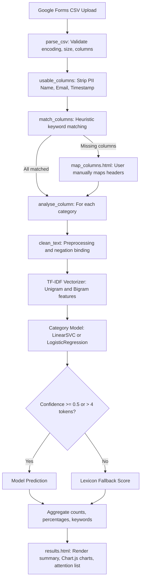

# Student Feedback Sentiment Analysis

A web application and machine learning pipeline that classifies college student feedback comments into **positive**, **neutral**, or **negative** sentiment across six academic categories. Designed for educators, course coordinators, and academic administrators who want to quickly process feedback forms without reading hundreds of comments manually.

---

## Table of Contents
1. [Title and Overview](#1-title-and-overview)
2. [Status Table](#2-status-table)
3. [Key Features](#3-key-features)
4. [How It Works](#4-how-it-works)
5. [Data](#5-data)
6. [Preprocessing](#6-preprocessing)
7. [The Model](#7-the-model)
8. [How the Model Is Evaluated](#8-how-the-model-is-evaluated)
9. [Results](#9-results)
10. [Installation](#10-installation)
11. [How to Run](#11-how-to-run)
12. [Using the Web App](#12-using-the-web-app)
13. [Configuration](#13-configuration)
14. [Project Structure](#14-project-structure)
15. [Testing](#15-testing)
16. [Limitations](#16-limitations)
17. [Future Work](#17-future-work)
18. [Troubleshooting](#18-troubleshooting)
19. [Acknowledgements and Attribution](#19-acknowledgements-and-attribution)

---

## 1. Title and Overview

**Student Feedback Sentiment Analysis** is a Python Flask web application backed by Scikit-Learn text classification pipelines. 

Students fill out an institutional Google Form with feedback on teaching, coursework, and campus facilities. Rather than evaluating all comments using a single generic model, this project uses six separate machine learning models—one trained specifically for each category:
1. Teacher Feedback
2. Course Content
3. Examination Pattern
4. Laboratory
5. Library Facilities
6. Extra Co-Curricular Activities

Each individual response is classified into one of three sentiment labels:
- **positive**: The student expresses satisfaction, appreciation, or praise.
- **neutral**: The student provides balanced, indifferent, or factual observations.
- **negative**: The student expresses dissatisfaction, criticism, or identifies shortcomings.

The application automatically hides student names, emails, and submission timestamps to protect student privacy.

---

## 2. Status Table

| Component | Status | Description |
|---|---|---|
| Data | Done | Six category JSON files (`feedback1.json` to `feedback6.json`) and an anonymized sample CSV (`samples/Student-Feedback-Form.csv`). |
| Preprocessing | Done | Shared NLTK pipeline in `preprocess.py` with URL stripping, tokenization, WordNet lemmatization, stopword filtering, and negation binding (`not_good`). |
| Training | Done | Stratified 5-fold cross-validation in `train.py` selecting between LinearSVC, Logistic Regression, and Multinomial Naive Bayes; saved via `joblib`. |
| Evaluation | Done | 5-fold cross-validation metrics (accuracy, macro-F1, confusion matrices, baselines) generated and saved to `models/metrics.json`. |
| Prediction | Done | In-memory prediction in `faculty.py` with low-confidence and short-answer lexicon fallback. |
| Web App | Done | Flask application in `app.py` with in-memory CSV parsing, column auto-matching, interactive column mapping, Chart.js visualizations, and CSV export. |
| Tests | Done | Pytest suite in `tests/test_analysis.py` covering 14 test scenarios including negation, blank values, bad uploads, and path safety. |
| Deployment | Partial | `Procfile` configured for Gunicorn (`web: gunicorn app:app`) on Linux servers. Windows service deployment is not configured. |

---

## 3. Key Features

- **Category-Specific Classifiers**: Uses dedicated models trained per category rather than forcing a single model across different domains.
- **Privacy by Design**: Automatically detects and excludes student names, email addresses, and timestamps before processing.
- **Negation-Aware Cleaning**: Connects negation words (`not`, `never`, `no`) to subsequent words (e.g., `not good` becomes `not_good`), preventing negative sentences from being classified as positive.
- **Short-Phrase Lexicon Fallback**: Applies an auxiliary lexicon for very brief responses (such as "good", "poor", "okay") where statistical n-gram counts provide low confidence.
- **Safe In-Memory Uploads**: Uploaded CSV files are read and processed directly in memory; files are never written to static or public web directories.
- **Flexible Column Matching**: Heuristic keyword detection maps form headers to categories automatically. If headers do not match, an interactive mapping form allows manual selection.
- **Client-Side Visualizations**: Renders dynamic doughnut and stacked bar charts using Chart.js in the browser, replacing static image generation.
- **Export & Print**: Allows downloading processed sentiment totals as a CSV file or printing a report with a dedicated print stylesheet.

---

## 4. How It Works

### Flowchart



### Step-by-Step Execution

1. **Upload**: The user uploads a CSV file through `index.html`.
2. **Validation & Privacy**: `parse_csv()` in `app.py` checks that the file is UTF-8, smaller than 2 MB, and contains more than two columns. Headers containing "name", "email", or "timestamp" are discarded.
3. **Column Mapping**: Headers are matched against keywords defined in `config.py`. If a category column cannot be identified, the file is staged temporarily in `uploads/` and `map_columns.html` prompts the user to select columns manually.
4. **Text Cleaning**: Every non-blank response is cleaned using `clean_text()` in `preprocess.py`.
5. **Feature Extraction**: Text is converted into numbers using a TF-IDF vectorizer that extracts single words and two-word pairs (unigrams and bigrams).
6. **Classification & Fallback**: The category model predicts sentiment. If a response is very short ($\le 4$ tokens) or model confidence is below 50%, an auxiliary rule-based lexicon verifies the polarity.
7. **Display**: `results.html` renders sentiment distributions, highest-negative attention areas, frequent keywords, sample comments, and interactive charts via `static/results.js`.

### Worked Preprocessing Example

Suppose a student submits this comment under Teacher Feedback:
```text
"Teachers are not good and interaction is very boring!"
```

1. **Lowercasing and punctuation removal**:
   `teachers are not good and interaction is very boring`
2. **Tokenization** (splitting into word units):
   `['teachers', 'are', 'not', 'good', 'and', 'interaction', 'is', 'very', 'boring']`
3. **Negation binding** (`attach_negations()` joins `not` to `good`):
   `['teachers', 'are', 'not_good', 'and', 'interaction', 'is', 'very', 'boring']`
4. **Lemmatization** (reducing words to their base dictionary form using WordNet):
   `teachers` $\to$ `teacher`, `boring` $\to$ `boring`, `not_good` $\to$ `not_good`
5. **Stopword removal** (removing common grammatical words like `are`, `and`, `is`, `very` while keeping negations):
   Final cleaned string:
   `"teacher not_good interaction boring"`

Because `not_good` is preserved as a single token, the model and lexicon identify this as negative rather than being misled by the word `good`.

---

## 5. Data

### Training Data Files (`feedback1.json` to `feedback6.json`)

The training datasets are located in the project root. Each JSON file is a list of entries formatted as `[tokens_list, label]`, where tokens were pre-split words and labels are `"positive"`, `"neutral"`, or `"negative"`.

The exact counts and class distributions in these files are:

| File | Category Name | Raw Rows | Unique Rows | Usable Rows | Negative | Neutral | Positive |
|---|---|---|---|---|---|---|---|
| `feedback1.json` | Teacher Feedback | 215 | 145 | 144 | 42 | 35 | 67 |
| `feedback2.json` | Course Content | 215 | 139 | 138 | 39 | 38 | 61 |
| `feedback3.json` | Examination Pattern | 215 | 130 | 129 | 38 | 39 | 52 |
| `feedback4.json` | Laboratory | 215 | 129 | 128 | 54 | 26 | 48 |
| `feedback5.json` | Library Facilities | 215 | 131 | 131 | 42 | 38 | 51 |
| `feedback6.json` | Extra Co-Curricular Activities | 215 | 128 | 127 | 33 | 26 | 68 |

*Note: Raw rows count includes duplicates present in the original files. "Unique Rows" represents deduplicated samples. "Usable Rows" excludes any empty strings resulting after stopword removal. Class counts shown reflect the usable samples used during model training.*

Sample raw row from `feedback1.json`:
```json
[["interaction", "student", "teacher", "teachers", "come", "teach", "dull", "manner", "without", "take", "doubt"], "negative"]
```

### Uploaded CSV Format

The application expects a standard CSV file exported from Google Forms with a header row. 
- Must be encoded in UTF-8 or UTF-8 with BOM.
- Must have more than 2 columns.
- Maximum file size: 2 MB.

### Column Detection Keywords

Columns are matched against candidate headers defined in `config.py`:

| Category ID | Category Name | Target Keywords |
|---|---|---|
| `teacher` | Teacher Feedback | teacher feedback, teacher, faculty, teaching, lecture delivery, punctuality |
| `course` | Course Content | course content, course, curriculum, syllabus, syllabi, contents |
| `exam` | Examination Pattern | examination pattern, exam pattern, examination, exam, question paper, question |
| `lab` | Laboratory | laboratory, laboratories, lab facility, lab |
| `library` | Library Facilities | library facilities, library, books availability |
| `extra` | Extra Co-Curricular Activities | extra co-curricular, co-curricular, extracurricular, extra curricular, curricular activities, activities |
| `suggestions` | Any other suggestion | any other suggestion, suggestion, other comment, remarks |

Columns matching PII headers (`name`, `email`, `timestamp`) are automatically ignored.

---

## 6. Preprocessing

Preprocessing is defined in `preprocess.py` and is identical for training data and inference:

1. **URL Removal**: Replaces `http://`, `https://`, and `www.` addresses with whitespace.
2. **Tokenization**: Uses a regular expression pattern (`n't|[a-z0-9]+`) that isolates alphanumeric words while preserving contraction endings like `n't`.
3. **Negation Attachment**: Scans token sequences. When a negation word (`not`, `no`, `never`, `nor`, `n't`) is detected, it attaches to the next content word after skipping adverbs such as `very`, `so`, `really`, `quite`, `too`. For example, `not very good` becomes `not_good`.
4. **Lemmatization**: Uses NLTK's `WordNetLemmatizer` to reduce plural nouns and verb conjugations to root forms. Adjectives ending in `-ing` (e.g., `boring`) are protected from over-lemmatization.
5. **Stopword Filtering**: Removes common English words from NLTK's stopword corpus, but explicitly retains negations (`not`, `no`, `never`, `nor`, `n't`).

### Before and After Comparison

| Input Text | Cleaned Output |
|---|---|
| `"Teachers are not good"` | `"teacher not_good"` |
| `"Very bad and poor facilities"` | `"bad poor facility"` |
| `"Lectures are not boring at all"` | `"lecture not_boring"` |
| `"Okay, not so good exam paper"` | `"okay not_good exam paper"` |

---

## 7. The Model

### Features vs. Classifier

In natural language processing, feature extraction and classification are two distinct steps:
- **Feature Extraction (TF-IDF)**: Words cannot be fed directly into mathematical equations. TF-IDF (Term Frequency-Inverse Document Frequency) measures how frequently a word appears in a comment relative to how common it is across all comments. The pipeline uses `TfidfVectorizer(ngram_range=(1, 2), min_df=1, max_df=0.95, sublinear_tf=True)`, which counts both individual words (unigrams) and adjacent word pairs (bigrams).
- **Classification Model**: The algorithm that makes the prediction based on those numerical features.

### Selected Algorithms

In `train.py`, three candidate algorithms were evaluated using cross-validation on each deduplicated category dataset:
1. **Linear Support Vector Classifier (`LinearSVC`)**: Finds an optimal linear boundary that separates different sentiment classes with maximum margin.
2. **Logistic Regression (`LogisticRegression`)**: Estimates the probability of each sentiment class using a logistic function.
3. **Multinomial Naive Bayes (`MultinomialNB`)**: A probabilistic classifier based on Bayes' theorem.

Both LinearSVC and Logistic Regression use `class_weight='balanced'` to prevent bias toward the majority class (positive).

### Best Model per Category

Based on cross-validation macro-F1 score:
- **Teacher Feedback**: `LinearSVC`
- **Course Content**: `LinearSVC`
- **Examination Pattern**: `LinearSVC`
- **Laboratory**: `LinearSVC`
- **Library Facilities**: `LinearSVC`
- **Extra Co-Curricular Activities**: `LogisticRegression`

Trained models are saved using `joblib` into `models/<category_id>.joblib`. At runtime, `app.py` and `faculty.py` load these files once into an in-memory cache and reuse them for all user requests.

---

## 8. How the Model Is Evaluated

### Evaluation Methodology

In `train.py`, models are evaluated using **Stratified 5-Fold Cross-Validation** on the deduplicated data. The dataset is split into 5 equal portions (folds), preserving the relative proportion of positive, neutral, and negative classes. Each model is trained on 4 folds and tested on the remaining fold, repeating 5 times so every sample is tested exactly once without data leakage.

### Explanation of Technical Terms

- **Train/Test Split**: Dividing data into two groups—one to teach the model and one to test it on unseen data.
- **Data Leakage**: A mistake where test information is accidentally shared with the model during training, causing false optimism.
- **Cross-Validation**: Splitting data into multiple folds and rotating testing across all folds to obtain a reliable score on small datasets.
- **Accuracy**: The fraction of all predictions that were correct out of the total predictions.
- **Precision**: When the model predicts a specific sentiment (e.g., negative), the percentage of those predictions that were truly negative.
- **Recall**: Out of all the actual negative comments that existed, the percentage the model managed to find.
- **F1-Score**: The harmonic mean of precision and recall, balancing false positives and false negatives.
- **Macro-F1**: The unweighted average of F1-scores across all three classes, giving equal importance to positive, neutral, and negative regardless of sample size.
- **Confusion Matrix**: A table showing exact counts of true categories versus predicted categories.
- **Majority-Class Baseline**: A dummy classifier that simply predicts the most common class for every sample, serving as the minimum benchmark.

### Gaps in Evaluation Note

The dataset contains only 127 to 144 usable samples per category. Because the dataset is small, there is no separate held-out test set beyond the 5-fold cross-validation folds. Additionally, the neutral class contains significantly fewer examples than positive or negative, resulting in lower recall on neutral comments across all categories.

---

## 9. Results

The following numbers are stored directly in `models/metrics.json` generated by `train.py`:

### Overall Benchmark Comparison

| Metric | Old Baseline (MultinomialNB) | New Trained Pipeline |
|---|---|---|
| **Mean Accuracy** | 62.00% | **62.71%** |
| **Mean Macro-F1** | 0.5500 | **0.5685** |

### Per-Category Cross-Validation Results

| Category | Selected Model | Accuracy | Macro-F1 | Majority Baseline Acc | Majority Baseline F1 |
|---|---|---|---|---|---|
| Teacher Feedback | LinearSVC | 67.36% | 0.6099 | 46.53% | 0.2117 |
| Course Content | LinearSVC | 59.42% | 0.5591 | 44.20% | 0.2044 |
| Examination Pattern | LinearSVC | 59.69% | 0.5804 | 40.31% | 0.1915 |
| Laboratory | LinearSVC | 64.06% | 0.5209 | 42.19% | 0.1978 |
| Library Facilities | LinearSVC | 58.78% | 0.5578 | 38.93% | 0.1868 |
| Extra Co-Curricular | LogisticRegression | 66.93% | 0.5826 | 53.54% | 0.2325 |

### Per-Class Performance Breakdown

| Category | Class | Precision | Recall | F1-Score | Support |
|---|---|---|---|---|---|
| **Teacher** | Positive | 0.696 | 0.821 | 0.753 | 67 |
| | Neutral | 0.381 | 0.229 | 0.286 | 35 |
| | Negative | 0.773 | 0.810 | 0.791 | 42 |
| **Course** | Positive | 0.640 | 0.787 | 0.706 | 61 |
| | Neutral | 0.469 | 0.395 | 0.429 | 38 |
| | Negative | 0.613 | 0.487 | 0.543 | 39 |
| **Exam** | Positive | 0.633 | 0.731 | 0.679 | 52 |
| | Neutral | 0.469 | 0.385 | 0.423 | 39 |
| | Negative | 0.649 | 0.632 | 0.640 | 38 |
| **Lab** | Positive | 0.704 | 0.792 | 0.745 | 48 |
| | Neutral | 0.250 | 0.077 | 0.118 | 26 |
| | Negative | 0.636 | 0.778 | 0.700 | 54 |
| **Library** | Positive | 0.661 | 0.804 | 0.726 | 51 |
| | Neutral | 0.387 | 0.316 | 0.348 | 38 |
| | Negative | 0.632 | 0.571 | 0.600 | 42 |
| **Extra** | Positive | 0.707 | 0.853 | 0.773 | 68 |
| | Neutral | 0.583 | 0.269 | 0.368 | 26 |
| | Negative | 0.606 | 0.606 | 0.606 | 33 |

### Confusion Matrices

Format: `[True Positive, True Neutral, True Negative]` across columns `[Pred Positive, Pred Neutral, Pred Negative]`.

- **Teacher Feedback**:
  ```text
  [[55,  9,  3],
   [20,  8,  7],
   [ 4,  4, 34]]
  ```
- **Course Content**:
  ```text
  [[48, 10,  3],
   [14, 15,  9],
   [13,  7, 19]]
  ```
- **Examination Pattern**:
  ```text
  [[38,  9,  5],
   [16, 15,  8],
   [ 6,  8, 24]]
  ```
- **Laboratory**:
  ```text
  [[38,  2,  8],
   [ 8,  2, 16],
   [ 8,  4, 42]]
  ```
- **Library Facilities**:
  ```text
  [[41,  8,  2],
   [14, 12, 12],
   [ 7, 11, 24]]
  ```
- **Extra Co-Curricular Activities**:
  ```text
  [[58,  2,  8],
   [14,  7,  5],
   [10,  3, 20]]
  ```

---

## 10. Installation

Python 3.10 to 3.14 is supported.

### Windows (PowerShell)

```powershell
# 1. Create a virtual environment
python -m venv .venv

# 2. Activate the virtual environment
.\.venv\Scripts\Activate.ps1

# 3. Upgrade pip and install dependencies
pip install --upgrade pip
pip install -r requirements.txt
```

### Linux / macOS

```bash
# 1. Create a virtual environment
python3 -m venv .venv

# 2. Activate the virtual environment
source .venv/bin/activate

# 3. Upgrade pip and install dependencies
pip install --upgrade pip
pip install -r requirements.txt
```

### NLTK Data

The application automatically downloads required NLTK packages (`punkt`, `wordnet`, `omw-1.4`, `stopwords`) on first run through `preprocess.ensure_nltk_data()`. Manual downloading is not required.

### Setup Helper Script

`scripts_setup_samples.py` is a one-off maintenance script used during development to strip PII from the raw form CSV, copy `form.pdf` to `samples/`, and delete legacy plot files. **You do not need to run this script.**

---

## 11. How to Run

Execute commands from the project root directory.

### Step 1: (Optional) Retrain Models
Pre-trained models are already provided in `models/`. To retrain and regenerate `models/metrics.json`:
```powershell
# Windows
.\.venv\Scripts\python train.py

# Linux / macOS
python train.py
```
*Output: Evaluates candidates across 5 folds, outputs training metrics, and writes 6 `.joblib` files and `models/metrics.json`.*

### Step 2: Run Automated Tests
```powershell
# Windows
.\.venv\Scripts\pytest

# Linux / macOS
pytest
```
*Output: Runs 14 test cases in `tests/test_analysis.py` verifying model independence, negations, input validation, and security.*

### Step 3: Start the Web App
```powershell
# Windows
.\.venv\Scripts\python app.py

# Linux / macOS
python app.py
```
*Output:*
```text
 * Serving Flask app 'app'
 * Running on http://127.0.0.1:5000
```
Open **http://127.0.0.1:5000** in your browser.

*Note on Gunicorn*: The `Procfile` specifies `web: gunicorn app:app`. Gunicorn is designed for Linux container/cloud hosting (such as Render or Heroku) and does not run natively on Windows.

---

## 12. Using the Web App

### 1. Uploading Feedback
- On the homepage (`/`), drag and drop a Google Forms feedback CSV file or click to browse.
- You can test the app using the provided sample at `samples/Student-Feedback-Form.csv`.
- Select whether to evaluate **"All categories"** or choose a single specific category using the category selector chips.
- Click **"Analyse feedback"**.

### 2. Column Mapping Fallback
- If the column names in your CSV do not match the standard category keywords, the app stages the file and renders `map_columns.html`.
- Use the dropdown menus to select which CSV column corresponds to each feedback category, then click "Continue analysis".

### 3. Results Dashboard
The results page (`results.html`) displays:
- **Summary Header**: Total rows analyzed, number of blank responses skipped, and net sentiment score.
- **Overall Stat Cards**: Total counts for Positive, Neutral, and Negative responses.
- **Overall Comparison Chart**: A horizontal stacked bar chart comparing sentiment distributions across all categories.
- **Needs Attention Panel**: Highlights categories with the highest proportion of negative comments ($\ge 25\%$).
- **Category Cards**: Contains a Chart.js doughnut chart, top keywords per sentiment label, and representative example comments with confidence percentages. Comments with $<50\%$ confidence are tagged as `uncertain`.
- **Any Other Suggestion**: Dedicated section displaying general open-ended comments and their sentiment.
- **Action Buttons**:
  - `Download results (CSV)`: Exports category sentiment counts as a client-generated CSV file.
  - `Print / Save as PDF`: Opens the print dialogue with print-optimized styles.
  - `Analyse another file`: Returns to the upload page.

### 4. Storage in `uploads/`
The `uploads/` folder is used exclusively for transient storage when a user must map columns manually. The uploaded file is saved as `uploads/<random_uuid>.csv` and is deleted immediately after the analysis is generated. Uploaded files that do not require column mapping are processed directly in memory and never touch disk.

---

## 13. Configuration

Configured in `config.py` and via environment variables:

### Settings in `config.py`

| Setting | Value / Type | Purpose |
|---|---|---|
| `MAX_CONTENT_LENGTH` | `2 * 1024 * 1024` (2 MB) | Maximum permitted upload file size. |
| `ALLOWED_EXTENSIONS` | `{"csv"}` | Allowed file upload extensions. |
| `PII_HEADER_TOKENS` | `("name", "email", ...)` | Headers automatically stripped to protect student privacy. |
| `LABELS` | `("positive", "neutral", "negative")` | Supported sentiment target classes. |
| `LOW_CONFIDENCE_THRESHOLD`| `0.5` | Threshold below which predictions are flagged as `uncertain`. |
| `SHORT_TEXT_TOKEN_LIMIT` | `4` | Maximum word count triggering short-answer lexicon verification. |
| `NEGATION_WORDS` | `{"not", "no", "never", "nor", "n't"}` | Words joined to subsequent tokens during cleaning. |
| `CATEGORIES` | `list[dict]` | Metadata (ID, display name, JSON training file, matching keywords). |
| `SUGGESTIONS` | `dict` | Metadata for the optional open-ended suggestions column. |

### Environment Variables

| Variable | Default | Purpose |
|---|---|---|
| `SECRET_KEY` | Auto-generated random bytes | Session signature key. Set to a static string in production. |
| `FLASK_DEBUG` / `DEBUG` | `0` (False) | Enables Flask debug mode when set to `1` or `true`. |
| `PORT` | `5000` | Port number on which the local server listens. |

---

## 14. Project Structure

```text
Student-Feedback-Sentiment-Analysis-main/
├── .gitignore                      # Git exclusion rules (__pycache__, uploads, venv)
├── .pytest_cache/                  # Cached test artifacts
├── .venv/                          # Local Python virtual environment
├── app.py                          # Flask application routes, upload handling, aggregation
├── config.py                       # Paths, category definitions, thresholds, lexicons
├── faculty.py                      # Model inference engine and lexicon fallback logic
├── feedback1.json                  # Training dataset: Teacher Feedback
├── feedback2.json                  # Training dataset: Course Content
├── feedback3.json                  # Training dataset: Examination Pattern
├── feedback4.json                  # Training dataset: Laboratory
├── feedback5.json                  # Training dataset: Library Facilities
├── feedback6.json                  # Training dataset: Extra Co-Curricular Activities
├── preprocess.py                   # NLTK cleaning, lemmatization, and negation binding
├── Procfile                        # Gunicorn production process definition
├── pytest.ini                      # Pytest discovery configuration
├── README.md                       # Project documentation
├── requirements.txt                # Pinned dependencies for Python environment
├── scripts_setup_samples.py        # One-off maintenance script used during refactoring
├── train.py                        # Model training and cross-validation benchmarking script
├── images/                         # Project diagrams and user interface screenshots
│   ├── 1.png                       # Legacy screenshot from original project
│   ├── 2.png                       # Legacy screenshot from original project
│   ├── 3.png                       # Legacy screenshot from original project
│   ├── error-card.png              # Screenshot of 400 error card
│   ├── flow.PNG                    # Legacy flowchart from original project
│   ├── README.md                   # Legacy empty markdown file
│   ├── results-desktop-light.png   # Desktop light mode results screenshot
│   ├── results-mobile-dark.png     # Mobile dark mode results screenshot
│   ├── results.PNG                 # Legacy results screenshot
│   ├── upload-desktop-light.png    # Desktop upload page screenshot
│   └── upload-mobile-dark.png      # Mobile dark mode upload page screenshot
├── models/                         # Serialized models and evaluation results
│   ├── .gitkeep                    # Keeps folder tracked in git
│   ├── course.joblib               # Serialized LinearSVC pipeline for Course Content
│   ├── exam.joblib                 # Serialized LinearSVC pipeline for Examination Pattern
│   ├── extra.joblib                # Serialized LogisticRegression pipeline for Extra-Curricular
│   ├── lab.joblib                  # Serialized LinearSVC pipeline for Laboratory
│   ├── library.joblib              # Serialized LinearSVC pipeline for Library Facilities
│   ├── metrics.json                # Stored cross-validation metrics and classification reports
│   └── teacher.joblib              # Serialized LinearSVC pipeline for Teacher Feedback
├── samples/                        # Sample data for testing
│   ├── form.pdf                    # Sample feedback questionnaire form
│   └── Student-Feedback-Form.csv   # Anonymized sample Google Forms CSV
├── static/                         # Frontend web assets
│   ├── results.js                  # Chart.js rendering and CSV export script
│   ├── style.css                   # Custom responsive CSS with dark mode support
│   └── upload.js                   # Client-side dropzone and file validation script
├── templates/                      # Jinja2 HTML templates
│   ├── base.html                   # Base layout with header, footer, accessibility links
│   ├── error.html                  # User-friendly HTTP 400 error card
│   ├── index.html                  # Drag-and-drop upload interface
│   ├── map_columns.html            # Interactive column mapping fallback interface
│   └── results.html                # Sentiment summary and visual dashboard
├── tests/                          # Automated testing suite
│   ├── conftest.py                 # Pytest fixtures and test client configuration
│   └── test_analysis.py            # 14 unit and integration test functions
└── uploads/                        # Temporary directory for staged uploads during column mapping
    └── .gitkeep                    # Keeps folder tracked in git
```

### Unused or Leftover Files Observed

- `scripts_setup_samples.py`: This was an internal migration script used to anonymize sample data and delete legacy matplotlib files; it is not called during normal operation.
- `images/README.md`: An empty 1-byte file located inside `images/`.
- `images/1.png`, `images/2.png`, `images/3.png`, `images/flow.PNG`, `images/results.PNG`: Legacy screenshot and flowchart images from the original repository before UI modernization.

---

## 15. Testing

The project uses `pytest` for automated testing.

### Running Tests

```powershell
# Windows
.\.venv\Scripts\pytest

# Linux / macOS
pytest
```

Configuration in `pytest.ini` automatically sets the Python path to the project root and points to the `tests/` directory.

### What the 14 Tests Cover

1. `test_neg_keys_are_independent`: Verifies that negative sentiment keys across categories do not overwrite one another.
2. `test_per_category_models_are_distinct`: Checks that each category pipeline is a distinct instance.
3. `test_training_data_is_deduplicated`: Verifies that deduplication reduces row count from 215 raw entries.
4. `test_negation_and_short_phrases_predict_negative`: Validates that negation binding correctly predicts negative sentiment for phrases like "Teachers are not good" and "okay not so good", while avoiding negative classification for "Lectures are not boring at all".
5. `test_blank_cells_are_skipped_and_counted`: Confirms that empty and NaN cells do not crash analysis and are correctly tallied.
6. `test_empty_file_returns_400`: Asserts that an empty file upload returns HTTP 400.
7. `test_png_upload_returns_400`: Asserts that a non-CSV upload returns HTTP 400.
8. `test_two_column_csv_returns_400`: Asserts that a CSV with $\le 2$ columns returns HTTP 400.
9. `test_non_numeric_cate_returns_400`: Asserts that passing an invalid category selector returns HTTP 400.
10. `test_missing_file_returns_400`: Asserts that submitting without a file returns HTTP 400.
11. `test_invalid_cate_helper`: Direct unit test of `parse_category_ids` invalid input handling.
12. `test_path_traversal_filename_does_not_write`: Verifies that filenames such as `../evil.csv` cannot write outside intended folders.
13. `test_sample_csv_counts_add_up`: Tests the complete flow on `samples/Student-Feedback-Form.csv`, verifying that category totals equal the sum of positive, neutral, and negative predictions.
14. `test_parse_csv_rejects_non_utf8`: Verifies that files encoded in non-UTF-8 encodings (e.g., Latin-1) return a friendly HTTP 400 error.

### What Is Not Covered

- Performance under high concurrent user load.
- Browser cross-compatibility testing across older versions of Internet Explorer / Safari.
- Live deployment testing in WSGI production environments.

---

## 16. Limitations

- **Small Training Dataset**: Each category model is trained on only ~127 to 144 unique samples, which limits generalization to varied sentence structures.
- **Underrepresented Neutral Class**: The training datasets have very few neutral comments (26 to 39 usable samples per category), leading to lower neutral recall (7.7% to 39.5%).
- **English Only**: The preprocessing and NLTK lemmatizers only support English. Comments written in regional languages or romanized Hindi (Hinglish) cannot be reliably classified.
- **No Sarcasm Detection**: Nuanced expressions of sarcasm (e.g., "Oh, wonderful, another canceled lecture") will likely be misclassified as positive based on keyword features.
- **Short-Phrase Dependence**: Very short comments ("ok", "good") rely on hardcoded keyword polarity in `config.py` rather than learned statistical patterns.

---

## 17. Future Work

- **Collect More Neutral Samples**: Expand the training dataset with balanced examples of neutral feedback.
- **Transformer Embeddings**: Experiment with lightweight transformer models (e.g., DistilBERT or RoBERTa) to capture deep semantic context and sarcasm.
- **Multilingual Support**: Add support for multilingual feedback and transliterated text.
- **Role-Based Authentication**: Provide password-protected logins for department heads and faculty members.
- **Automated Trend Tracking**: Compare feedback sentiment across consecutive academic semesters.

---

## 18. Troubleshooting

| Issue | Cause | Solution |
|---|---|---|
| `ModuleNotFoundError: No module named 'flask'` | Python running outside the virtual environment. | Ensure `.venv` is activated: `.\.venv\Scripts\Activate.ps1` (Windows) or `source .venv/bin/activate` (Linux/macOS). |
| `FileNotFoundError: Model not found for teacher` | Models have not been trained yet. | Run `python train.py` once to train and save all six pipelines. |
| `LookupError: Resource punkt_tab not found` | NLTK data download was interrupted or blocked. | Run `python -c "import nltk; nltk.download('punkt'); nltk.download('wordnet'); nltk.download('stopwords')"` |
| `Address already in use (Port 5000)` | Another application or previous Flask process is running on port 5000. | Set a different port via environment variable: `$env:PORT="5001"; python app.py` (PowerShell) or `PORT=5001 python app.py` (Linux/macOS). |
| `This CSV does not have enough columns` | Uploaded CSV has 2 or fewer columns. | Ensure the uploaded CSV is an unedited export from Google Forms with individual question columns. |

---

## 19. Acknowledgements and Attribution

This project is derived from the open-source repository [Student-Feedback-Sentiment-Analysis](https://github.com/) (originally developed for student feedback analysis at UIET, Panjab University).

### Reused Components
- The six labeled training datasets (`feedback1.json` through `feedback6.json`).
- The sample feedback questionnaire (`samples/form.pdf`).
- The core category structure and domain keywords.
- Legacy screenshots (`images/1.png`, `images/2.png`, `images/3.png`, `images/flow.PNG`, `images/results.PNG`).

### New and Modernized Components
- Modular architecture: introduced `config.py`, `preprocess.py`, `train.py`, and `pytest.ini`.
- Preprocessing engine: added NLTK WordNet lemmatization, stopword management, and negation binding.
- Machine learning upgrade: replaced repetitive runtime Naive Bayes retraining with persistent Scikit-Learn pipelines (`LinearSVC` and `LogisticRegression`) trained using 5-fold cross-validation.
- Security and robustness: implemented in-memory stream processing, PII redaction, path traversal protection, and HTTP 400 error handling.
- UI redesign: replaced server-side Matplotlib chart generation with Chart.js, added drag-and-drop file upload, dark mode support, and CSV export.
- Complete automated test suite (`tests/test_analysis.py`).

### Licence

No licence file found in the repository.

---
*Last updated: 2026-11-03*
*Metrics and counts source note: Data sizes and sample counts were read directly from `feedback1.json`–`feedback6.json` and `samples/Student-Feedback-Form.csv`. Model accuracy, macro-F1, confusion matrices, and baseline scores were copied verbatim from `models/metrics.json`.*
